# Customer Churn Prediction

A machine learning project built on the IBM Telco dataset that predicts 
which customers are likely to cancel their subscription, estimates how much 
revenue is at risk, and ranks customers by retention priority so that 
intervention budgets go to the right people.

---

## The Problem

Telecom companies lose a significant portion of their customer base every year 
to churn. The challenge is not just predicting who will leave — it is knowing 
*which* departures hurt the most financially, and acting before it is too late.

This project approaches churn as a business decision problem, not just a 
classification task. Every prediction feeds into a priority scoring system 
that weights churn probability against customer lifetime value and contract 
type, so a retention team can open the dashboard and immediately know where 
to focus.


---

## What the project does

**Exploratory analysis** (`notebooks/01_eda.ipynb`)  
Walks through the dataset to understand who churns and why. Key findings:
- Customers in their first 12 months churn at ~48%, nearly double the overall rate.
- Month-to-month contracts drive the highest churn (42.7%).
- Fiber optic users churn at ~42%, likely driven by price sensitivity.
- Electronic check payers churn at 45.3%, the highest of any payment method.

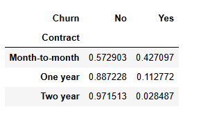
*Churn rate drops dramatically with contract length — from 42.7% on 
month-to-month down to just 2.8% on two-year contracts. Contract type 
is one of the strongest retention levers in the dataset.*

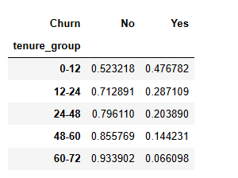
*Churn is front-loaded: the first 12 months are the highest risk window by a wide margin.*

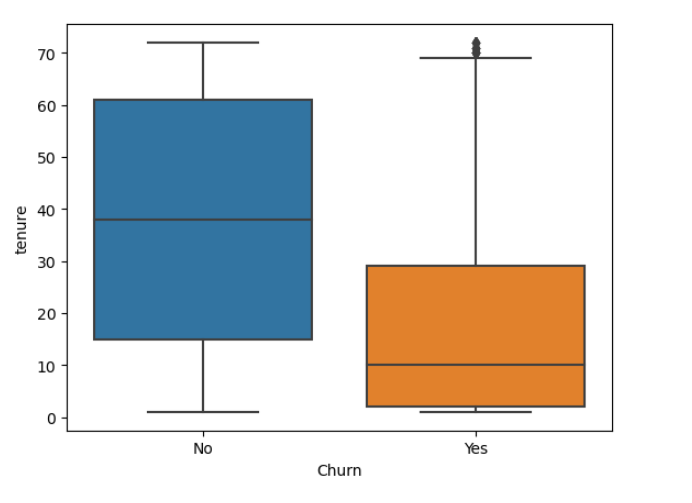
*Churners leave much earlier: median tenure around 12 months versus 38 months 
for retained customers. Getting a customer past their first year significantly 
improves long-term retention odds.*

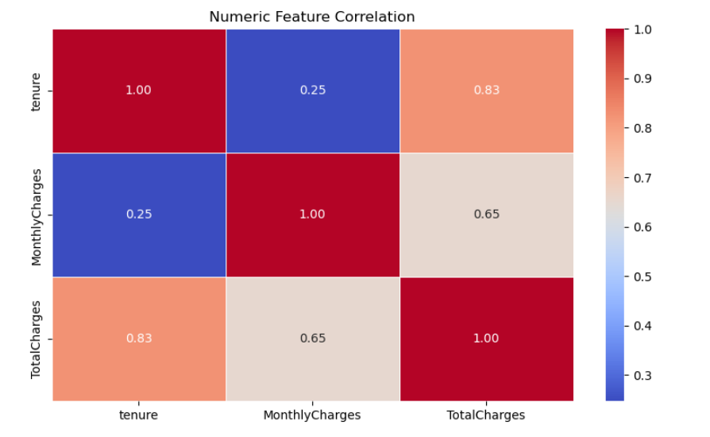
*TotalCharges is largely a product of tenure × MonthlyCharges. CLV replaces it in the model with clearer business meaning.*


**Modeling** (`notebooks/02_modeling.ipynb`)  
Compares Logistic Regression, Random Forest, and Gradient Boost using 
5-fold cross-validation before committing to a model. Logistic Regression 
(balanced) was selected — not because it had the highest AUC, but because 
it catches 80% of actual churners versus 52% for Gradient Boost, while 
the AUC difference was only 0.0005. At a cost ratio of $300 per missed 
churner versus $10 per false alarm, recall matters more than marginal AUC gains.

---

## Modeling results

**Model selection**  
Three candidates were evaluated with 5-fold cross-validation before 
committing to a final model.

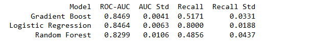
*Gradient Boost edges out a slightly higher AUC, but Logistic Regression 
catches 80% of actual churners versus 52%, a gap that matters far more 
than 0.0005 AUC when missing a churner costs $300 in lost revenue.*

---

**What drives churn: two methods compared**  
Both LR coefficients and SHAP independently rank MonthlyCharges, 
InternetService_Fiber optic, and tenure as the top three drivers. 
When two different methods agree, the signal is reliable.

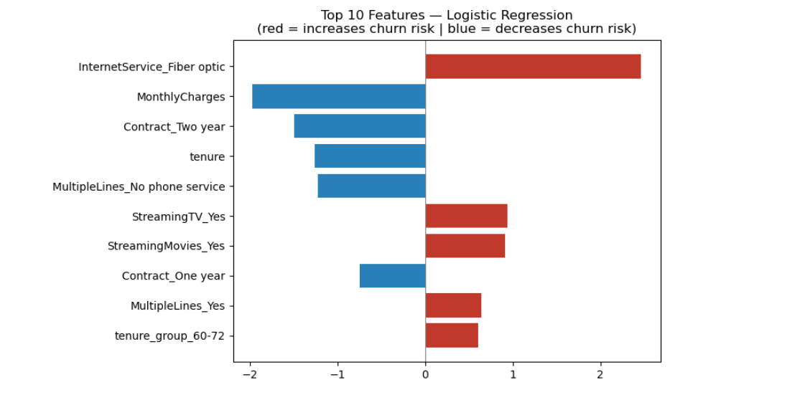
*Logistic Regression coefficients after StandardScaling. Red bars push 
the prediction toward churn, blue bars push away from it. Fiber optic 
internet is by far the strongest positive signal.*

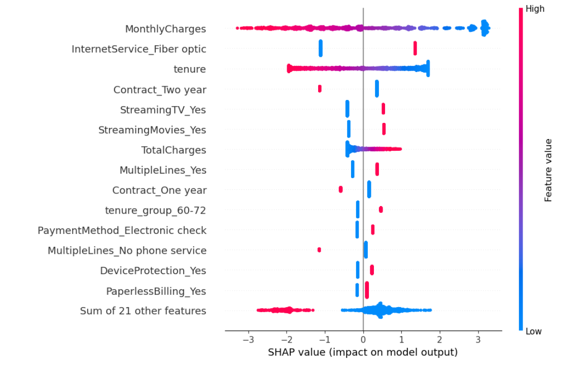
*SHAP beeswarm: each dot is one customer. Color shows whether the feature 
value was high (red) or low (blue) for that person. High MonthlyCharges 
consistently increases churn probability across the entire customer base.*

---

**Probability calibration**  
Since predicted probabilities feed directly into CLV scoring and expected 
revenue calculations, it matters whether they are actually trustworthy.

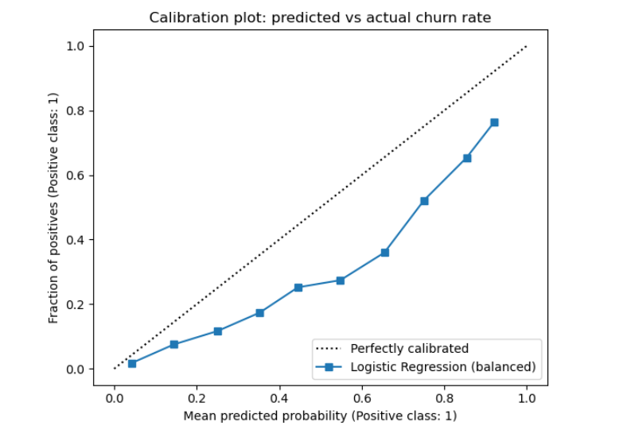
*The model slightly underestimates churn probability in the 0.4–0.7 range 
but tracks well at the extremes. Good enough for business prioritization; 
CalibratedClassifierCV could tighten this further if needed.*

---

**CLV vs churn probability**  
The scatterplot shows why raw churn probability alone is not enough for 
prioritization. A customer at 0.9 probability with $200 CLV is less urgent 
than one at 0.7 probability with $4,000 CLV.

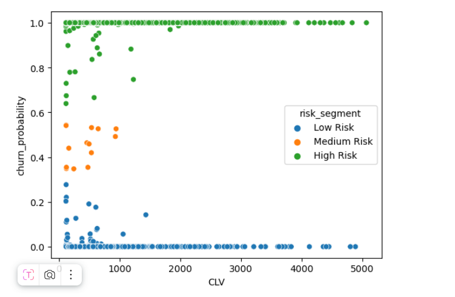
*Green dots in the upper right corner are the highest-priority retention 
targets — high churn risk and high customer value. The priority score 
formula surfaces exactly these customers.*


**Streamlit app** (`app/app.py`)  
Three modes for different use cases:

| Mode | What it does |
|---|---|
| Predict New Customer | Enter hypothetical customer details and get an instant churn prediction with CLV and priority score |
| Select Existing Customer | Pick any customer from the dataset and analyze their churn risk |
| Dashboard | See all high-risk customers ranked by priority score, with KPI cards and CSV export |

---

## Key results

| Metric | Score |
|---|---|
| ROC-AUC | 0.8464 |
| Recall (threshold = 0.3) | 0.80 |
| Total customers scored | 7,032 |
| Revenue at risk identified | $2,017,173 |


## App screenshots

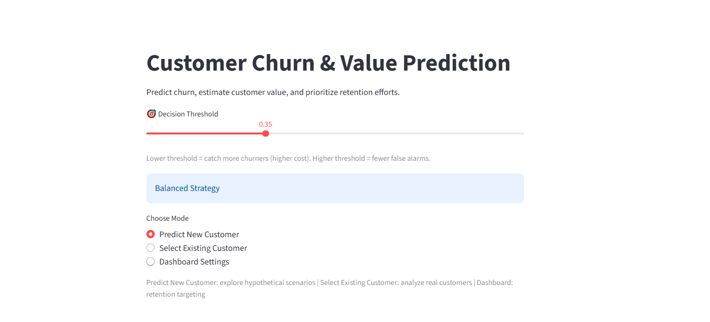
*The decision threshold slider sits at the top of every mode — adjusting 
it shifts the model between aggressive (catch more churners) and 
conservative (fewer false alarms) strategies without retraining anything.*

---

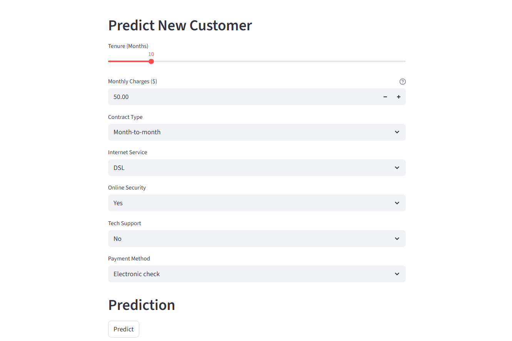
*Mode 1: Enter any customer profile and get an instant prediction. All 
features the model was trained on are available as inputs, so the 
prediction reflects the full customer picture rather than a partial guess.*

---

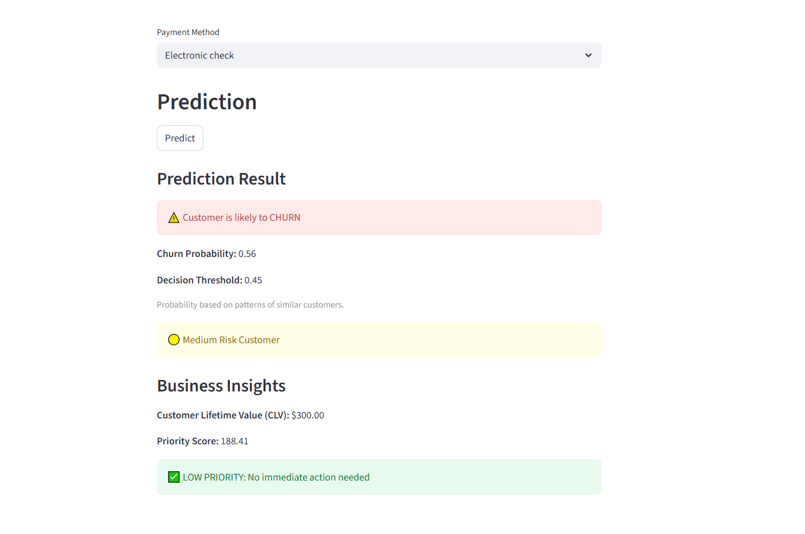
*Each prediction comes with three layers: the binary outcome, a risk 
segment (Low / Medium / High), and business insights: CLV and priority 
score tell the retention team how urgently to act, not just whether to act.*

---

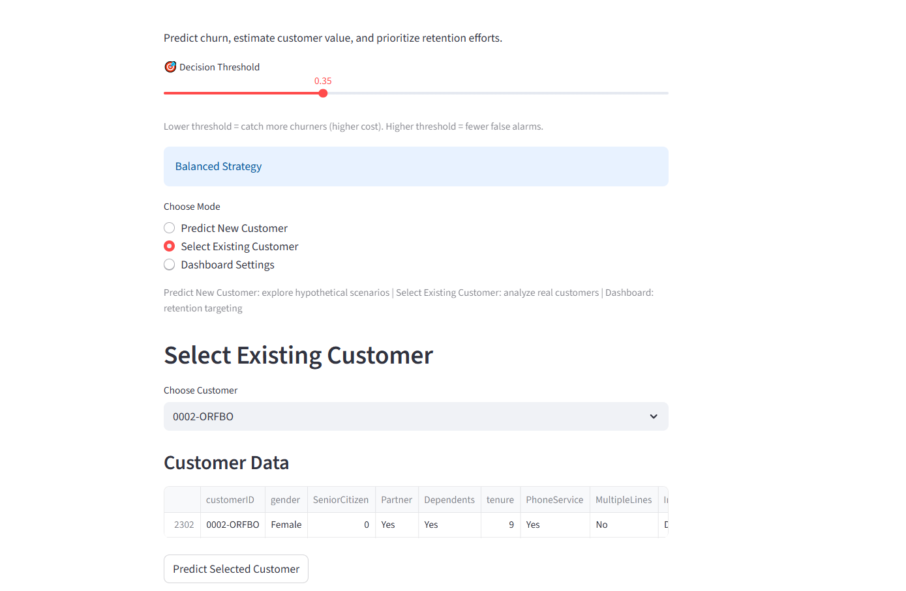
*Mode 2: Pick any real customer from the dataset by ID. Their full profile 
loads automatically, so there's no manual data entry: just select and predict.*

---

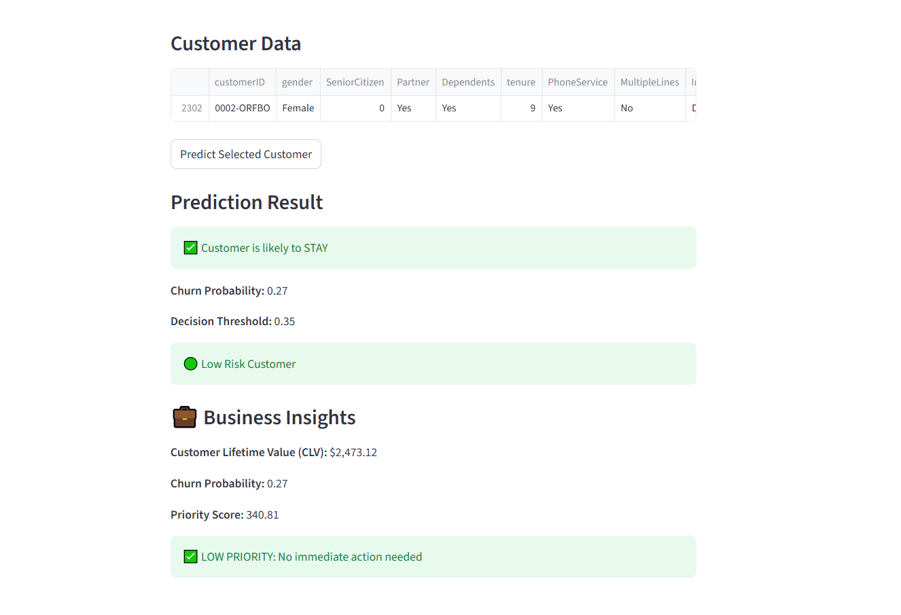
*The same business insights apply to existing customers. Customer 0002-ORFBO 
has a CLV of $2,473 but a churn probability of only 0.27 — low priority 
despite high value, which is exactly the kind of nuance raw probability 
alone would miss.*

---

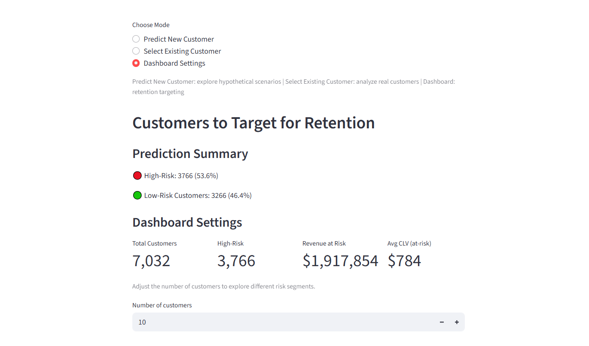
*Mode 3: The dashboard scores all 7,032 customers at once. At a 0.35 
threshold, 3,766 customers are flagged as high-risk with $1.9M in revenue 
at stake. Results export to CSV with one click.*

---

## How priority scoring works

Each at-risk customer gets a priority score:

```
priority_score = (churn_probability ^ 1.5) × CLV × contract_weight
```

- *"p^1.5"*: amplifies high-confidence predictions non-linearly. 
  A customer at 0.9 probability ranks much higher than one at 0.5, 
  not just 1.8× higher.
- *"CLV"*: revenue at stake. A high-value customer who might leave 
  outranks a low-value customer with the same churn probability.
- *"contract_weight"*: month-to-month customers are weighted 1.5×, 
  one-year 1.0×, two-year 0.7×, reflecting how much easier 
  short-contract customers are to lose.

---

## Project structure

```
customer-churn-prediction/
├── data/
│   ├── raw/               # Original Telco CSV (download link below)
│   └── processed/         # Cleaned dataset from EDA notebook
├── notebooks/
│   ├── 01_eda.ipynb       # Exploratory analysis
│   └── 02_modeling.ipynb  # Model training and evaluation
├── app/
│   ├── app.py             # Streamlit app
│   ├── app_data.csv       # Dataset for live predictions
│   └── *.pkl              # Saved model and preprocessing artifacts
├── images/
├── requirements.txt
└── README.md
```


---

## How to run

```bash
git clone https://github.com/yourusername/customer-churn-prediction.git
cd customer-churn-prediction
pip install -r requirements.txt
streamlit run app/app.py
```

To reproduce the model from scratch, run the notebooks in order:
1. `notebooks/01_eda.ipynb` — cleans the data and saves to `data/processed/`
2. `notebooks/02_modeling.ipynb` — trains the model and saves artifacts to `app/`

---

## Data

**Dataset:** [Telco Customer Churn](https://www.kaggle.com/datasets/blastchar/telco-customer-churn) — IBM sample dataset, publicly available on Kaggle.

Download the CSV and place it at `data/raw/Telco-Customer-Churn.csv` before 
running the EDA notebook.

---

## Tech stack

Python · scikit-learn · SHAP · Streamlit · pandas · seaborn · matplotlib

---

## Author

**Yusif**  
[LinkedIn](https://linkedin.com/in/yusif-sharbatov) · [GitHub](https://github.com/Ysharbat)